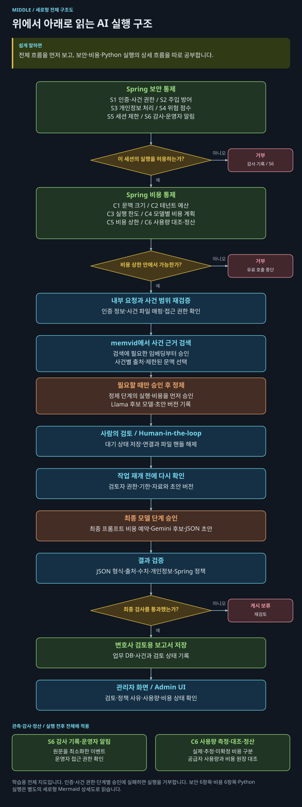
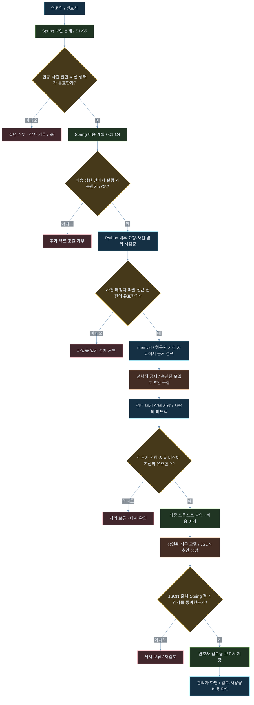
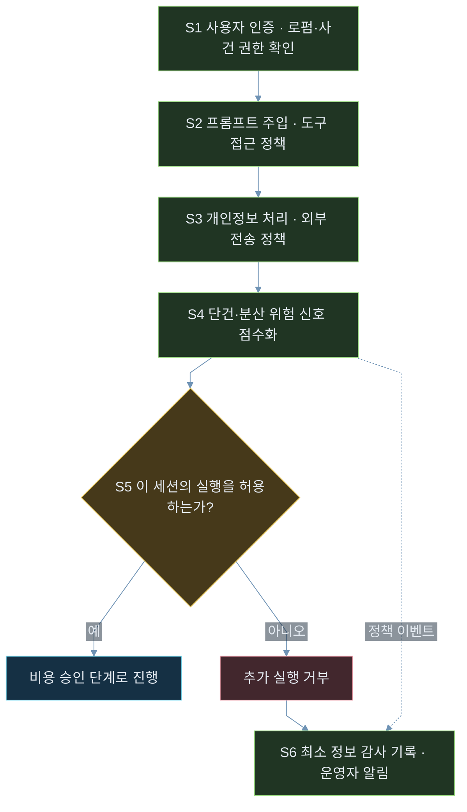
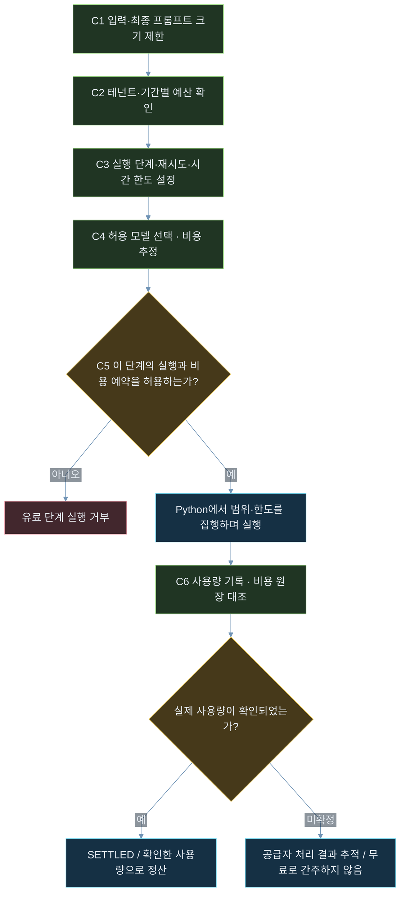
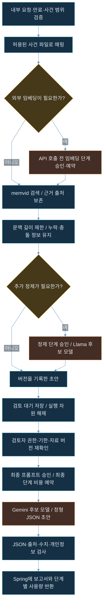
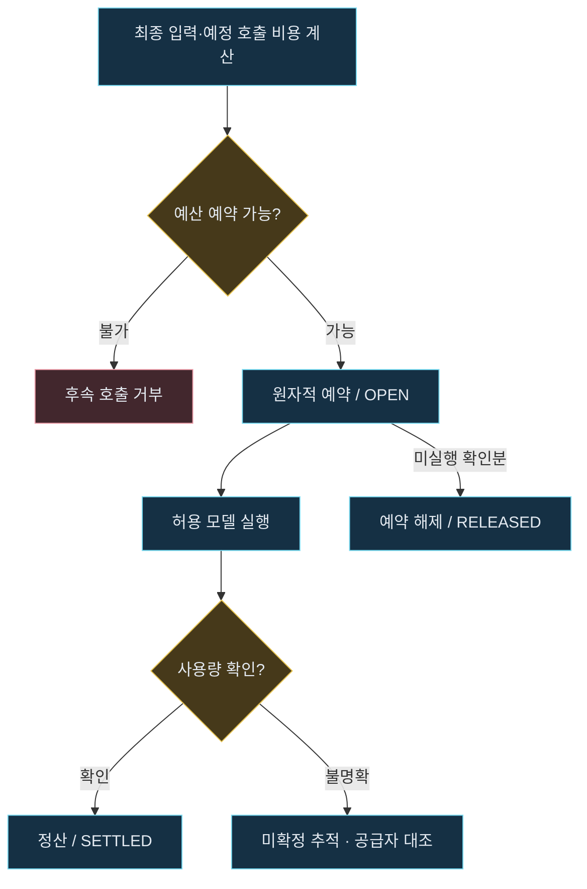

# 엔터프라이즈 AI 하이브리드 구조 - 한국어 학습판

[English](README.md) · [용어·예시·확인 문제로 공부하기](docs/study-guide.ko.md)

### Spring Boot Control Plane + Python FastAPI + memvid

> **Spring이 권한과 예산을 통제하고, Python이 실행하며, memvid가 사건의 기억을 보관합니다.**

법률 상담 인테이크를 대상으로, 업무 통제와 AI 실행을 분리하는 하이브리드 백엔드 설계입니다. Java 21 기반 Spring Boot가 인증·사건 권한·보안 정책·비용 원장을 담당하고, Python FastAPI는 memvid 기반 근거 검색과 모델 작업을 수행합니다.

**Architecture Theme**

**Deterministic Spring Control Plane + Serverless Python Memory Layer**

여기서 *Deterministic*은 명시적인 정책·한도·상태 전이로 실행을 통제한다는 뜻입니다. 생성 모델의 답변까지 결정적이라는 의미는 아닙니다. *Serverless*는 memvid 검색을 위해 별도 DB 서버를 운영하지 않는 구성을 가리키며, FastAPI 실행 자원과 운영 비용은 필요합니다.

**상태: 아키텍처 설계·학습 자료 정리 단계.** 이 문서는 통합 구현·운영 검증 완료를 선언하지 않습니다. 보안 6항목과 비용 6항목은 이 설계의 통제 책임 분류입니다.

## 해결하려는 문제

법률 인테이크에는 모델 호출 외에도 사건 접근 권한, 의뢰인 정보 보호, 근거 추적, 사용량 정산, 관리자 검토가 필요합니다. 이 설계는 상담 원문을 검토 가능한 자료로 정리하고 변호사의 상담 준비를 돕는 데 초점을 둡니다.

| 제품 요구 | 설계 방향 |
|---|---|
| 다른 사건의 자료가 섞이지 않아야 함 | 인증된 로펌·사건 범위와 파일 매핑을 함께 검증 |
| 요약의 근거를 확인할 수 있어야 함 | 주요 주장에 문서·청크 출처 연결, 미확인 진술 표시 |
| 유료 호출이 예산 안에서 실행되어야 함 | 호출 전 원자적 예약, 단계별 한도, 사용량 정산 |
| 운영자가 결과와 실패를 이해해야 함 | 검토 상태·정책 사유·비용 상태·감사 기록 제공 |
| 검색 인프라를 단순하게 운영하고 싶음 | 사건별 memvid 파일과 별도 업무 DB로 책임 분리 |

## 전체 구조 - 세로형 학습 지도

위에서 아래로 전체 흐름을 읽고 보안·비용·Python 실행을 따로 펼쳐 보세요. 긴 교차선을 줄이기 위해 네 개의 세로형 도식으로 나눴습니다.

<strong>1. 전체 흐름</strong>

<strong>2. 보안 통제 S1-S6</strong>

<strong>3. 비용 통제 C1-C6</strong>

<strong>4. Python 실행 상세</strong>

원본 파일: [전체 구조](docs/architecture-full.ko.mmd) · [보안](docs/security-controls.ko.mmd) · [비용](docs/cost-controls.ko.mmd) · [Python 실행](docs/python-execution.ko.mmd)

상세도는 정상 흐름을 중심으로 보여줍니다. 인증·사건·파일 권한과 단계별 승인 실패는 실행을 거부하도록 구현합니다. S6 감사와 C6 정산은 실행 전후 전체에 적용되며 한 번만 통과하는 직렬 필터가 아닙니다.

이 구조는 통제 지점을 설명하는 설계입니다. 실제 격리·정산·품질은 [증거 수집 계획](docs/evidence/README.ko.md)에 따라 검증해야 합니다.

## Spring · Python · memvid 역할 정리

| 비교 항목 | Spring Boot · Java 21 | Python FastAPI | memvid |
|---|---|---|---|
| 핵심 역할 | 업무·정책 통제 | AI 작업 실행·조정 | 파일 기반 문서·검색 메모리 |
| 사용자와 사건 | 로그인·담당자·로펌·사건 권한 확정 | 내부 인증·승인 범위 집행 | 앱이 부여한 범위에서 자료 저장·조회 |
| 데이터 | 사건·예약·보고서 상태·비용 원장 | 마스킹된 입력·근거·생성 결과 | 문서·메타데이터·임베딩·인덱스 |
| 보안 | 정책 버전·세션 제한·감사 | 입력·검색 자료·출력 검사, 실행 상한 | 파일 권한·암호화·ACL과 연계 |
| 비용 | 예산 승인·원자적 예약·정산 정책 | 단계별 호출과 실제 사용량 보고 | 로컬 자원 사용, 외부 임베딩 선택 가능 |
| 동시성 | 가상 스레드·연결 상한·백프레셔 | I/O·CPU 작업 분리, 작업 수 제한 | 파일 핸들·잠금·동시 쓰기 검증 |
| 변경 단위 | 업무 규칙·권한·요금 정책 | 모델·프롬프트·실행 흐름 | SDK·파일 형식·검색·색인 설정 |

역할 분리는 언어의 우열에 대한 주장이 아닙니다. Python으로도 통제 계층을 구현할 수 있으며, 여기서는 기존 Spring 업무 백본과 Python AI 생태계를 결합하는 방식을 선택합니다.

Java 21 가상 스레드는 I/O 대기 중심의 동시 처리에 활용합니다. 모델 추론이나 CPU 계산 자체를 빠르게 만드는 기능은 아니며, DB·HTTP 연결과 외부 API 동시성 한도는 별도로 관리합니다. [Java 21 공식 설명](https://docs.oracle.com/en/java/javase/21/core/virtual-threads.html)

## 3단계 처리 파이프라인

### 1. Spring 인바운드 게이트

로그인과 사건 접근 권한을 확인하고 PII·입력 정책·세션 상태를 검사합니다. 내부 실행 요청에는 요청 ID, 승인된 사건 범위, 정책 버전, 실행 기한을 연결합니다.

### 2. Spring 비용 통제와 실행 승인

초기 입력 크기와 테넌트 예산을 확인하고 허용 모델·반복 횟수·시간·출력량을 정합니다. 검색·임베딩·중간 정제·최종 생성은 단계별로 예산을 확인합니다. 최종 입력이 커지거나 승인 범위가 바뀌면 추가 예약 없이 실행하지 않습니다.

### 3. FastAPI + memvid 실행, Spring 검증·저장

Python은 사건 메모리를 검색하고 필요한 근거를 선택합니다. 선택적 정제와 사람 검토를 거친 뒤 허용된 모델로 보고서를 생성합니다. Python의 JSON·출처 검사와 Spring의 최종 정책 검증 후 관리자 검토 상태로 저장하며 사용량을 정산합니다.

## 보안 통제 6항목

| 항목 | 책임과 적용 방식 |
|---|---|
| 1. 인증·테넌트 매핑 | Spring이 로그인 사용자·로펌·사건 권한을 DB로 확인. Python도 내부 토큰과 사건 범위 검증 |
| 2. 프롬프트 주입 방어 | 사용자 입력과 검색된 문서를 신뢰하지 않는 자료로 취급. 명령 실행·도구 접근은 별도 허용 정책 적용 |
| 3. PII 마스킹 | 형식 기반 정규식과 추가 탐지·검토를 조합. 사건 내 일관된 치환 표식 사용, 복원 매핑과 로그 분리 |
| 4. 침입 위험 점수 | 단건·반복·분산 시도의 신호와 사유·정책 버전을 기록. 점수를 정답 확률이나 비용으로 취급하지 않음 |
| 5. 누적 세션 제한 | 임계치에 따라 해당 AI 작업의 새 호출을 거부하고 실행 중 작업에 취소 전달. 로그인 무효화 여부는 별도 정책 |
| 6. 운영자 보고·감사 | 원문을 최소화한 이벤트·점수·처리 상태를 관리자 화면에 반영. 전달 실패·중복·접근 권한도 관리 |

정규식만으로 이름과 자유 서술의 모든 민감정보를 탐지할 수는 없습니다. 사건번호처럼 검색에 필요한 식별자는 무조건 삭제하기보다 정책에 따라 치환하고, 외부 전송 직전에도 입력과 근거를 검사합니다.

## 비용 통제 6항목

| 항목 | 책임과 적용 방식 |
|---|---|
| 1. 컨텍스트 크기 | 초기에 바이트·문자·파일 크기를 제한하고, 호출 직전에 모델별 토큰 수와 출력 상한을 계산 |
| 2. 테넌트 예산 | 사용자·로펌·기간 예산에서 확정 사용량과 진행 중 예약을 반영해 잔액 판단 |
| 3. 루프·호출 제한 | Python 실행기에도 최대 단계·도구 호출·재시도·시간 한도를 집행. 외부 게이트 검사만으로 내부 반복을 통제하지 않음 |
| 4. 모델별 라우팅 | 난이도·품질·비용 평가로 허용 모델 선택. 중간 정제·외부 임베딩·상위 모델 호출 비용까지 포함 |
| 5. 하드 캡 | 승인되지 않은 후속 호출 거부, 출력 상한·기한·동시성 제한, 작업 단위 취소·격리 실행 적용 |
| 6. 미터링·정산 | 요청·단계·모델별 사용량을 영속 원장에 기록. 실제·추정·미확정·예약 비용을 구분해 대시보드 표시 |

전체 Python 서버를 종료하면 다른 사건도 영향을 받으므로 하드 캡은 작업 단위로 설계합니다. 공급자가 이미 처리한 토큰은 취소로 되돌릴 수 없으며, 타임아웃만으로 예약을 전액 해제하지 않습니다.

## Python 실행 흐름: memvid → 정제 → 사람 검토 → 최종 보고서

| 단계 | 역할 | 실행 조건 |
|---|---|---|
| 1. 사건 메모리 선택 | 승인된 사건을 기존 `.mv2` 파일에 매핑하고, 신규 생성은 명시된 적재 작업에서 수행 | 내부 인증·권한·경로·수명 확인 |
| 2. 근거 검색 | 키워드·의미 검색으로 관련 문단을 선택하고 출처·충돌·미확인 항목 보존 | 임베딩 모델·색인 일치, 문맥 한도 준수 |
| 3. 선택적 정제 | Llama 계열 등을 후보로 분류·초안 구성 | 정제의 품질·토큰 절감 효과가 비용을 정당화할 때 |
| 4. Human-in-the-loop | 초안과 출처를 보여주고 검토자가 보완·승인 | 검토 권한·기한·초안 버전 확인 |
| 5. 최종 추론 | Gemini 계열 등을 후보로 검토 의견과 근거에서 JSON 초안 생성 | 승인된 모델 ID·예산·입출력 스키마 |
| 6. 검증·반환 | 출처·수치·JSON·PII를 검사하고 Spring에 결과와 사용량 보고 | 최종 관리자 검토·업무 DB 저장 |

Llama와 Gemini는 모델 계열이며 구체적인 모델 ID·실행 위치·가격은 설정과 평가로 정합니다. **“CEO”는 최종 검토 에이전트의 역할명**으로만 사용하며 제품명이나 우수성 보장으로 취급하지 않습니다. 단순 요청은 정제나 상위 모델 단계를 생략할 수 있습니다.

사람의 피드백을 기다릴 때는 상태를 `AWAITING_REVIEW`로 저장하고 HTTP 연결·파일 핸들을 계속 유지하지 않습니다. 재개 시 권한·정책·자료 버전을 다시 확인하고, 바뀐 입력의 추가 비용을 승인한 뒤 이어서 실행합니다.

## memvid 도입 원칙

memvid는 데이터를 단일 `.mv2` 파일에 보관하는 메모리 레이어입니다. 별도 검색 DB 서비스를 줄이는 것이 도입 목적이며, 원문 준비·문서 분할·임베딩·근거 검증은 여전히 필요합니다. [공식 프로젝트](https://github.com/memvid/memvid)

| 항목 | 이 프로젝트의 선택 |
|---|---|
| 기본 분리 단위 | 사건별 파일. 로펌 단위 권한에 더해 사건 담당 권한 확인 |
| 업무 데이터 | 사건·예약·보고서 상태·비용 원장은 관계형 DB에 유지 |
| 공통 지식 | 공개 법률·절차 자료는 별도 메모리로 관리하고 출처 구분 |
| 임베딩 | 로컬·외부 API 중 언어·품질·예산·전송 정책에 따라 선택 |
| 파일 접근 | 원시 경로를 외부 입력으로 받지 않고 서버 매핑으로 해석 |
| 생성·쓰기 | 재조회 때마다 생성하지 않음. 기존 파일 보존·잠금·동시 쓰기 검증 |
| 보호·보관 | 파일 권한·암호화·키 관리·캐시·임시 평문·백업·삭제 정책 적용 |

파일 분리는 별도 하드웨어 수준의 물리적 격리와 다릅니다. memvid ACL을 사용하더라도 앱이 권한 메타데이터와 서버 측 인증 문맥을 제공하고 차단 모드로 집행해야 합니다. [공식 ACL 설명](https://docs.memvid.com/concepts/permission-aware-retrieval)

검색 지연, 한국어 법률 정확도, 비용 절감은 우리 데이터로 측정합니다. 프로젝트의 sub-5ms 홍보 수치를 요청 전체의 지연 보장으로 사용하지 않으며, 외부 임베딩 모델을 선택해도 오검색·근거 누락 가능성은 남습니다.

## 연동 계약의 최소 구성

아래는 구현할 API 계약의 설계 항목입니다. 확정된 엔드포인트나 OpenAPI 명세를 대신하지 않습니다.

| 구분 | 필수로 합의할 항목 |
|---|---|
| 인증 헤더 | 단기 내부 토큰, 발급자·대상·만료·권한 범위. 전송 구간 보호 |
| 작업 식별 | `request_id`, `job_id`, 재전송 키와 본문 일치 정책 |
| 사건 범위 | 인증 문맥의 `tenant_id`, `case_id`, 검토자 권한. 본문 값과 일치 검사 |
| 입력·자료 | `masked_input`, 허용 `document_ids`, 문서·정책·스키마 버전 |
| 실행 한도 | 기한, 최대 단계·재시도·문맥·출력·허용 모델, 예산 예약 참조 |
| 사람 검토 | 검토 대기·승인·거부·수정, 초안 버전과 재개 권한 |
| 결과 | 보고서 상태, 주장별 출처, 타임라인, 누락 자료, 검토 필요 표시 |
| 비용·실패 | 호출별 usage·과금 상태·모델 ID, 재시도 가능 여부, 취소·부분 성공 처리 |

최종 보고서는 청구 관련 요약, 핵심 자료, 타임라인, 추가 확인 항목, 다음 작업을 구조화합니다. 당사자 진술과 제출 자료로 확인된 사실을 구분하고, 법률 판단과 대외 제공 전 검토 상태를 명시합니다.

## 검증 계획

| 검증 영역 | 통과 기준을 정할 사례 |
|---|---|
| 접근 경계 | 다른 로펌·사건·검토자의 요청과 캐시 경로에서 자료가 반환되지 않음 |
| 메모리 무결성 | 생성·종료·재개방·검색·잠금·복원·삭제 후 재조회 시험 |
| 근거 품질 | 한국어 평가집의 정답 문서 재현율, 출처 오류, 부정·충돌 진술 누락 측정 |
| 실행 통제 | 최대 단계·기한·모델·출력 한도를 우회하는 내부 호출 차단 |
| 예산·정산 | 동시 예약·중복 종료·취소·타임아웃·usage 미수신 시험 |
| 사람 검토 | 대기 중 재시작, 권한 해제, 오래된 초안 승인, 자료 변경 후 재개 시험 |
| 운영 | 검색·전체 응답 p50/p95, 대기열, 요청당 원가, 복구 시간 관측 |

## 구현 순서

1. 인증된 로펌·사건 범위와 내부 작업 계약을 고정합니다.
2. 가상 자료로 memvid 저장·재개방·검색·출처 어댑터를 만듭니다.
3. 정책 검사와 영속 예산 예약·사용량 정산을 연결합니다.
4. 단일 모델 생성과 JSON·출처 검증을 먼저 완성합니다.
5. 선택적 정제·사람 검토·상위 모델 경로를 평가 후 추가합니다.
6. 관리자 화면·관측·복구·격리 시험을 마친 범위부터 적용합니다.

## 상세 학습 자료

아래 PDF는 가로형 태블릿 다크 모드이며, 클릭 목차와 벡터 흐름도를 포함합니다.

- [memvid 입문·실습·도입 가치](docs/MEMVID_BEGINNER_DARK_TABLET.pdf)
- [Spring Boot + FastAPI + memvid 하이브리드 구조](docs/SPRING_FASTAPI_MEMVID_HYBRID_DARK_TABLET.pdf)
- [FastAPI 예습 노트 · memvid 개정판](docs/FASTAPI_PREVIEW_MEMVID_DARK_TABLET.pdf)

이 패키지는 아키텍처 README와 학습 문서를 제공합니다. 실행 가능한 통합 애플리케이션은 포함하지 않으며, 런타임·SDK·모델 버전과 설치·배포 방법은 실제 구현 저장소에서 고정해야 합니다.
