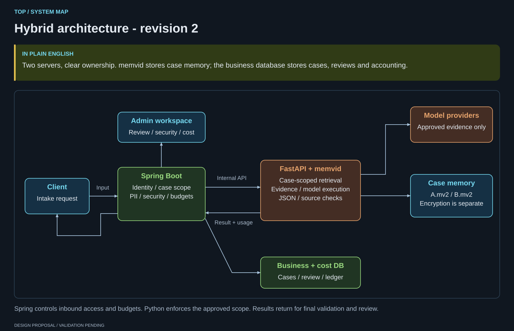
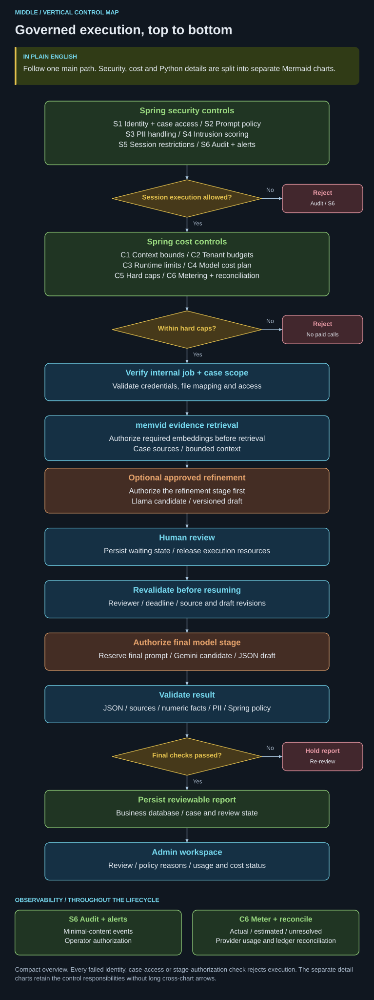
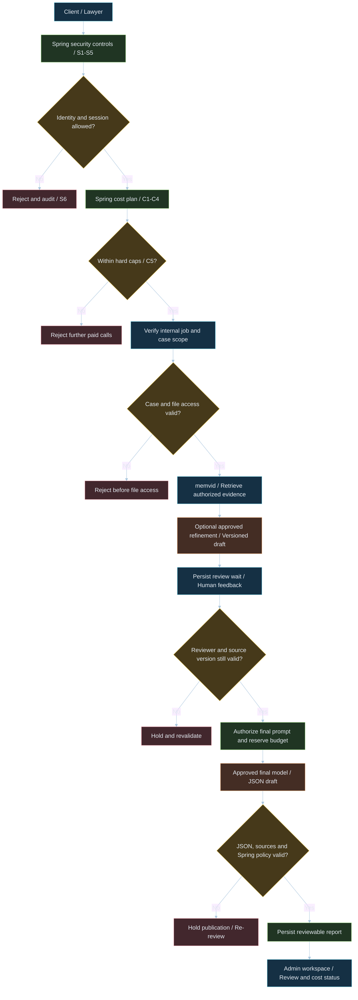
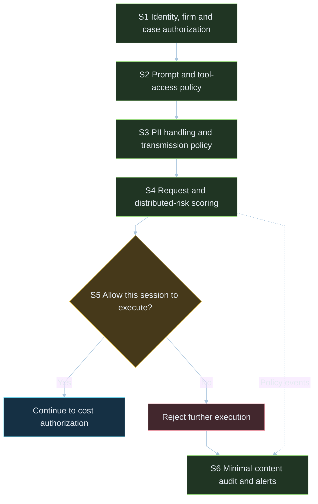
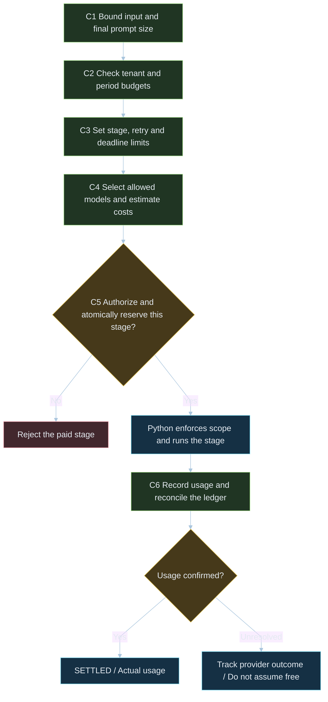
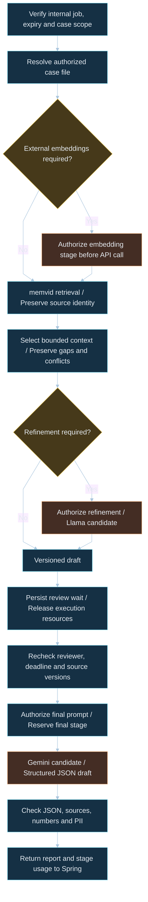
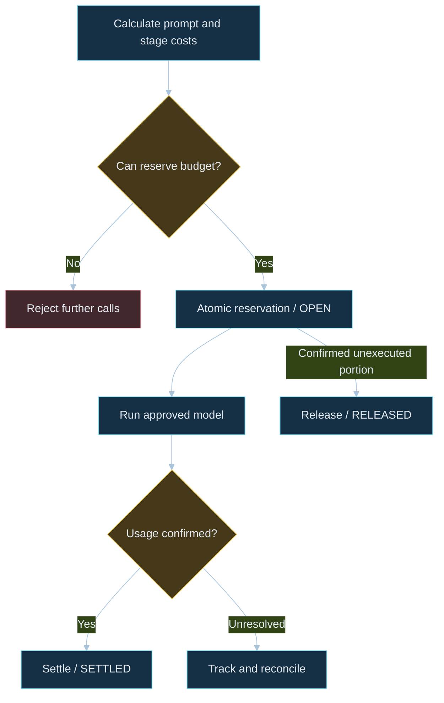

# Enterprise AI Hybrid Architecture

[Korean study edition](README.ko.md)

### Spring Boot Control Plane + Python FastAPI + memvid

**Spring authorizes. Python executes. memvid remembers.**

A legal-intake backend architecture that separates business governance from AI execution. Spring Boot on Java 21 owns identity, case access, policies, and the cost ledger. Python FastAPI retrieves evidence from memvid and runs authorized model stages.

**Theme:** Deterministic Spring Control Plane + Serverless Python Memory Layer

**Status:** Architecture proposal and learning materials. Integration, performance, and production security have not been validated. The six security controls and six cost controls are design responsibilities, not twelve verified production gates.

## Architecture at a glance

“Deterministic” describes explicit policies, limits, and state transitions; it does not make generated answers deterministic. “Serverless” describes memory access without a separate search database server. FastAPI still needs compute, storage, backups, and operations.

Solid arrows indicate request, response, or data flow. Dashed arrows indicate policy enforcement or metering. Green identifies Spring governance, orange model execution, blue memory and data, yellow decisions, and red rejection or hold states.

## What this design addresses

| Product requirement | Architectural response |
|---|---|
| Keep unrelated case data out of results | Validate tenant and case authorization before resolving a memory file |
| Make summaries reviewable | Link claims to source documents and chunks; distinguish statements from verified evidence |
| Keep paid work within limits | Reserve budget atomically and enforce stage, retry, deadline, and output caps |
| Explain failures and spending | Preserve review status, policy reasons, audit events, and accounting states |
| Simplify retrieval operations | Use case-level memvid files alongside a separate business database |

The product organizes intake information for lawyer review. It does not automatically establish facts or deliver final legal judgments.

## Full control architecture

Read the main path from top to bottom. Short rejection branches stay next to their decision. Security, cost and Python execution are separate detail charts so policy and accounting arrows no longer cross the entire architecture.

<strong>1. Vertical overview</strong>

<strong>2. Security controls / S1-S6</strong>

<strong>3. Cost controls / C1-C6</strong>

<strong>4. Python execution details</strong>

[Overview Mermaid](docs/architecture-full.mmd) · [Security](docs/security-controls.mmd) · [Cost](docs/cost-controls.mmd) · [Python](docs/python-execution.mmd)

The overview intentionally groups responsibilities. The security and execution detail charts show the normal path; any failed identity, file-access, session or stage-authorization check must reject execution. S6 audit and C6 metering observe the lifecycle, including failure and cancellation; neither is a one-time serial filter. Human review is shown for the reviewed path, and any bypass needs a separate policy.

## Who owns what?

| Concern | Spring Boot / Java 21 | Python FastAPI | memvid |
|---|---|---|---|
| Primary role | Business and policy control | AI workflow execution | File-based document memory and retrieval |
| Identity and cases | Establish user, firm, assignment, and case permissions | Verify internal credentials and enforce scope | Store and query within application-defined boundaries |
| Data | Cases, bookings, report states, cost ledger | Masked input, evidence, model output | Content, metadata, embeddings, indexes |
| Security | Policy versions, session restrictions, audit | Input, retrieved-content, output, and runtime checks | File permissions, encryption, and ACL integration |
| Cost | Approvals, atomic reservations, settlement policy | Stage-level calls and usage reporting | Local resources and optional external embeddings |
| Concurrency | Virtual threads, connection limits, backpressure | Separate I/O and CPU work; bound jobs | Validate handles, locks, and concurrent writes |
| Change boundary | Business rules, permissions, pricing | Models, prompts, orchestration | SDK, file format, search and indexing |

This division is an engineering choice, not a claim that Python cannot implement governance. It combines a Spring business backbone with the Python AI ecosystem.

Java 21 virtual threads support concurrency for I/O-heavy workloads. They do not accelerate inference or CPU work; database, HTTP, and provider concurrency still require limits. [Java documentation](https://docs.oracle.com/en/java/javase/21/core/virtual-threads.html)

## Three-stage pipeline

### 1. Spring inbound gate

Authenticate the user, establish case permissions, inspect input, apply PII handling, and check session policy. Bind each job to request identity, case scope, policy version, and deadline.

### 2. Spring cost authorization

Check initial input size and tenant budget. Specify allowed models, stages, retries, deadlines, and output limits. Account for embeddings, refinement, and final generation separately. Re-authorize the actual prompt and expanded scope before additional paid work.

### 3. FastAPI execution and Spring validation

Resolve authorized case memory, retrieve evidence, and assemble bounded context. Run optional refinement and human review, then an approved final model stage. Validate JSON, sources, numbers, and policy; return usage and save a reviewable report.

## Six security controls

| ID | Control | Responsibility |
|---|---|---|
| S1 | Identity and tenant mapping | Spring checks user, firm, and case access; Python verifies internal identity and scope |
| S2 | Prompt and tool policy | Treat input and retrieved content as untrusted data; authorize tools separately |
| S3 | PII handling | Combine pattern rules with detection and review; separate reversible mappings and logs |
| S4 | Intrusion scoring | Record repeated and distributed signals with reasons and policy versions |
| S5 | Session execution restrictions | Deny new AI calls at thresholds and propagate cancellation; login revocation is separate |
| S6 | Audit and alerts | Expose minimal-content events; handle authorization, duplicate delivery, and failures |

Regular expressions cannot detect every sensitive detail in free text. Preserve needed identifiers through policy-defined placeholders. Recheck selected evidence before external transmission.

## Six cost controls

| ID | Control | Responsibility |
|---|---|---|
| C1 | Context size | Bound uploads initially; calculate model-specific prompt tokens and output caps before calls |
| C2 | Tenant budget | Include confirmed usage and open reservations in user, firm, and period budgets |
| C3 | Loop and call limits | Enforce stage, tool-call, retry, and deadline limits inside Python |
| C4 | Model routing | Evaluate quality and cost; include embeddings and intermediate stages |
| C5 | Hard caps | Reject unauthorized calls, bound output/concurrency, and cancel isolated jobs |
| C6 | Metering and settlement | Persist usage; distinguish actual, estimated, unresolved, and reserved costs |

Cancel individual jobs rather than killing a shared server. Cancellation cannot reverse tokens already processed. A timeout alone is not evidence that a reservation can be fully released.

## Execution: memory, refinement, review, final report

| Stage | Role | Preconditions |
|---|---|---|
| 1. Select memory | Resolve an existing `.mv2`; create memory through explicit ingestion | Credentials, permissions, path, and lifecycle checks |
| 2. Retrieve evidence | Select passages with sources; preserve contradictions and gaps | Matching embedding/index configuration and context limits |
| 3. Optional refinement | Evaluate a Llama candidate for categorization or drafting | Demonstrated benefit that justifies the extra call |
| 4. Human review | Present draft and sources for feedback | Reviewer authorization, deadline, and draft revision |
| 5. Final inference | Evaluate a Gemini candidate for structured JSON | Approved model ID, prompt, schema, and budget |
| 6. Validate and return | Check JSON, sources, numbers, PII, and usage | Final policy validation and administrative review |

Llama and Gemini are model families, not fixed deployments or prices. **“CEO” is only a role name for a final-review agent**, not a product name or quality guarantee. Simple requests may skip refinement or escalation.

Persist `AWAITING_REVIEW` while waiting for feedback. Release HTTP connections and file handles. On resume, recheck identity, policy, source versions, and any additional budget required by changed input.

## Why memvid here?

memvid packages memory in a single `.mv2` file. The goal is to reduce the footprint of a separate search database. Ingestion, chunking, embeddings, and evidence validation remain application responsibilities. [Official project](https://github.com/memvid/memvid)

| Decision | Project policy |
|---|---|
| Isolation unit | Case-level files plus firm and assignment checks |
| Business data | Keep bookings, cases, report states, and accounting in a relational database |
| Shared knowledge | Store permitted public material separately and preserve source identity |
| Embeddings | Choose local or external providers by language, quality, budget, and transmission policy |
| File access | Resolve server mappings; never trust a client-supplied raw path |
| Creation and writes | Preserve existing files; validate locks, concurrency, and recovery |
| Protection | Manage permissions, encryption, keys, caches, temporary plaintext, backups, and deletion |

File separation is not hardware-level isolation. ACL features require correct metadata, authenticated server-side context, and enforcement configuration. [ACL documentation](https://docs.memvid.com/concepts/permission-aware-retrieval)

Measure latency, Korean legal retrieval quality, and cost on project data. A sub-5ms retrieval figure is not an end-to-end latency guarantee. External embeddings do not eliminate retrieval errors.

## What would count as evidence?

> Combine single-file memory with enforceable case boundaries, authorized paid execution, source validation, and auditable settlement.

The diagrams explain intended control points. **Evidence status: planned; no measurements attached.**

| Claim | Design mechanism | Required evidence |
|---|---|---|
| Authorized case material only | S1, scope checks, file mapping | Cross-tenant, cross-case, cache, and direct-API tests |
| Calls respect budgets | C1-C5, reservations, runtime enforcement | Concurrent reservation, loop, retry, and cancellation traces |
| Paid work is traceable | C6, call IDs, persistent ledger | Usage reconciliation, including unresolved calls |
| Summaries are reviewable | Source-preserving retrieval and review | Evaluation set, source errors, reviewer correction time |
| Search operations are simpler | Case files and business storage separation | Matched-workload total cost, maintenance, and recovery comparison |

Using memvid alone does not imply a breach; adding Spring does not automatically prove complete isolation. Zero operating cost, flawless security, and superiority to Grok or other products are not established claims. Comparisons require matched workloads, threat models, versions, configurations, and criteria.

See the [evidence plan](docs/evidence/README.md) for test IDs and reporting requirements.

## Integration contract: minimum fields

These are design requirements, not an implemented OpenAPI specification.

| Area | Required agreement |
|---|---|
| Credentials | Short-lived token, issuer, audience, expiry, scope, protected transport |
| Job identity | `request_id`, `job_id`, idempotency key, matching-body policy |
| Case scope | Authenticated `tenant_id`, `case_id`, reviewer rights; reject inconsistent body values |
| Evidence | `masked_input`, permitted `document_ids`, source/policy/schema versions |
| Runtime | Deadline, stages, retries, context/output caps, allowed models, reservation reference |
| Review | Waiting, approval, rejection, edits, draft revision, resume authorization |
| Result | Report status, claim-level sources, timeline, missing data, review requirement |
| Failure and cost | Per-call usage, billing state, model ID, retry/cancellation/partial-completion rules |

Reports structure claim-related summaries, evidence, timelines, gaps, and next actions. Distinguish client statements from supported facts and preserve review status before external delivery.

## Validation and implementation order

| Area | Cases to cover |
|---|---|
| Access | Other firms, unassigned cases, revoked reviewers, caches, bypass paths |
| Memory | Create, close, reopen, retrieve, lock, restore, verify deletion |
| Evidence | Recall@k, wrong sources, dates, amounts, negation, contradictions |
| Runtime | Unauthorized stages, deadlines, models, tool calls, output growth |
| Accounting | Concurrent reservations, duplicate settlement, cancellation, missing usage |
| Review | Restarts, stale drafts, revoked access, changed sources |
| Operations | Retrieval/end-to-end p50/p95, queues, request cost, recovery time |

1. Fix identity, case-scope, and job contracts.
2. Build a synthetic-data memvid ingestion, reopen, retrieval, and source adapter.
3. Connect policies to persistent reservations and usage reconciliation.
4. Validate a single-model generation path and JSON/source checks first.
5. Add refinement, human review, and escalation after evaluation.
6. Roll out tested boundaries with administrative visibility and recovery procedures.

## Learning materials

The companion PDFs below are **in Korean**. They use landscape dark layouts, clickable navigation, and vector diagrams. This README, the Mermaid source, and architecture assets are in English.

- [memvid fundamentals, exercises, and adoption considerations](docs/MEMVID_BEGINNER_DARK_TABLET.pdf)
- [Spring Boot + FastAPI + memvid hybrid architecture](docs/SPRING_FASTAPI_MEMVID_HYBRID_DARK_TABLET.pdf)
- [FastAPI preview notes: memvid edition](docs/FASTAPI_PREVIEW_MEMVID_DARK_TABLET.pdf)

This package contains documentation, not a runnable integrated application. Pin runtime, SDK, and model versions and provide setup instructions in the implementation repository.
